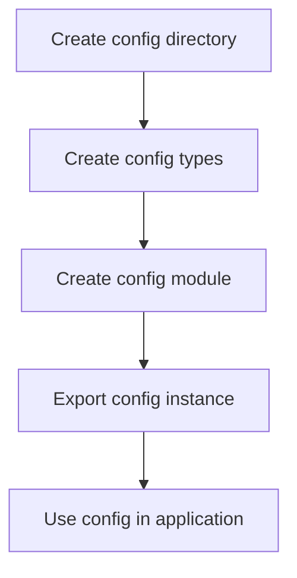
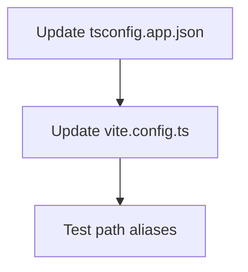
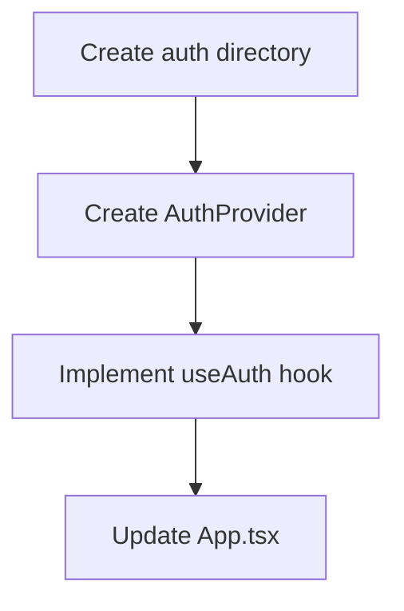
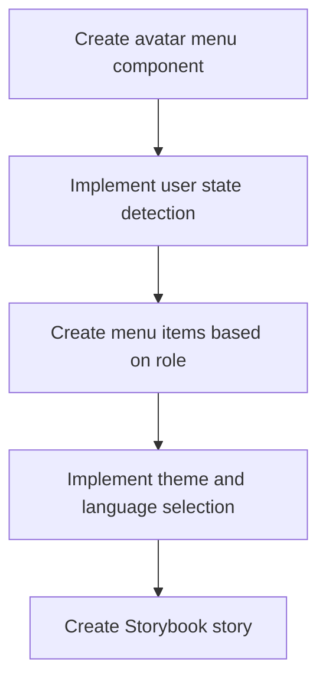

# Implementation Plan for Pergola Frontend Enhancements

## Overview

We need to implement the following features:

1. Create a global, type-safe application configuration that centralizes access to Vite's environment variables
2. Set up path aliases with @ prefix for improved import readability
3. Implement an authentication helper using the configuration
4. Create an avatar menu component with a Storybook story

## Detailed Implementation Plan

### 1. Global Application Configuration



#### Steps:

1. **Create a config directory structure**:
   - Create `src/config` directory
   - Create files: `types.ts`, `index.ts`

2. **Define TypeScript types for the configuration**:
   - Create interfaces for all configuration sections
   - Define environment variable types
   - Ensure type safety for all config values

3. **Create the configuration module**:
   - Read values from import.meta.env
   - Provide default values where needed
   - Add validation for required values
   - Create a singleton instance for the entire application

4. **Configuration structure**:
   ```typescript
   // Example structure
   interface AppConfig {
     api: {
       url: string;
     };
     auth: {
       oidcAuthority: string;
       clientId: string;
       redirectUri: string;
       scope: string;
       // Other OIDC-related values
     };
     // Other configuration sections as needed
   }
   ```

### 2. Path Aliases Setup



#### Steps:

1. **Update tsconfig.app.json**:
   - Add path mappings for all required directories
   - Configure baseUrl to be 'src'

2. **Update vite.config.ts**:
   - Add resolve.alias configuration to match tsconfig paths
   - Ensure both TypeScript and Vite use the same path mappings

3. **Path alias mapping**:
   ```typescript
   // Example configuration
   {
     "@components": "/src/components",
     "@pages": "/src/pages",
     "@store": "/src/store",
     "@theme": "/src/theme",
     "@i18n": "/src/i18n",
     "@assets": "/src/assets",
     "@config": "/src/config"
   }
   ```

### 3. Authentication Helper Implementation



#### Steps:

1. **Create auth directory structure**:
   - Create `src/auth` directory
   - Create files: `AuthProvider.tsx`, `index.ts`

2. **Implement AuthProvider component**:
   - Use the global config for OIDC settings
   - Implement as shown in the example provided
   - Ensure proper typing for all props and components

3. **Export useAuth hook**:
   - Re-export the hook from react-oidc-context
   - Add any additional functionality needed

4. **Update App.tsx**:
   - Wrap the application with the AuthProvider
   - Ensure proper nesting with other providers

### 4. Avatar Menu Component



#### Steps:

1. **Create avatar menu component**:
   - Create `src/components/ui/AvatarMenu.tsx`
   - Implement a popup menu for the avatar
   - Use Material-UI components for consistent styling

2. **Implement user state detection**:
   - Use the auth hook to detect login state
   - Show login button when not logged in
   - Show avatar and menu when logged in

3. **Create menu items based on user role**:
   - Language selection
   - Theme toggle (dark/light)
   - "My Profile" link
   - "Garden Settings" link (for admin role)
   - Logout button

4. **Create Storybook story**:
   - Create `src/stories/AvatarMenu.stories.tsx`
   - Include stories for different states:
     - Not logged in
     - Logged in as regular user
     - Logged in as admin

## Implementation Sequence

1. First, set up the path aliases to make subsequent development easier
2. Create the global configuration module
3. Implement the authentication helper
4. Develop the avatar menu component and Storybook story

## File Structure Changes

```
frontend-vite/
└── src/
    ├── config/
    │   ├── types.ts         (new)
    │   └── index.ts         (new)
    ├── auth/
    │   ├── AuthProvider.tsx (new)
    │   └── index.ts         (new)
    ├── components/
    │   └── ui/
    │       └── AvatarMenu.tsx (new)
    └── stories/
        └── AvatarMenu.stories.tsx (new)
```

## Configuration Files to Update

1. `tsconfig.app.json` - Add path aliases
2. `vite.config.ts` - Configure path resolution
3. `src/main.tsx` or `src/App.tsx` - Integrate AuthProvider